<div align="center">

## 🌳 CLADE: Category-Level Answering from Deficient Evidence in Retrieval-Augmented Language Models

[](paper/CLADE.pdf)
[](LICENSE)
[](#-run-it)
[](DATA.md)
[](#-run-it)

`retrieval-augmented generation` · `knowledge graphs` · `ontologies` · `abstention` · `agents`

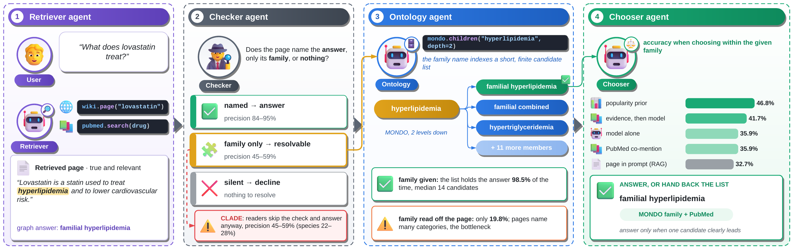

</div>

---

## 🧩 The problem

A search tool hands a model a page. The page is true. The page is on topic.
But it names only the answer's **family**, not the answer itself.

| 🔎 The question asks for… | 📄 The page only says… |
|---|---|
| 🩺 a specific disease: *hyperlipidemia, familial combined, LPL related* | "hyperlipidemia" |
| 🦋 a specific plant: *Antennaria plantaginifolia* | "the pussytoes (*Antennaria*)" |

The page cannot settle the answer. But the gap is easy to close: the family name points to a short list in an ontology or a taxonomy.
We call this **resolvable insufficiency**.

A good agent should notice it and hand the question on ("look up the family members").
Instead, models often just pick a family member and answer. We call that failure **CLADE**: *category-level answering from deficient evidence*.

> **Our question:** When a page names only the family, do models decline, or do they guess?

---

## 🎯 What we do

- 📄 **We sort pages** into three types: the page **names** the answer 🟢, names **only its family** 🟡, or says **nothing** ⚪.
- ❓ **We ask** five language models multiple-choice questions. All wrong options come from the answer's own family. One option is "Not enough information to tell".
- ⚖️ **We compare** family-only pages with silent pages. Neither page holds the answer, so a careful model should decline on both.
- ✂️ **We edit** pages on purpose: we swap the answer's name for its family name. This shows cause, not just correlation.
- 🌍 **We repeat** everything in a second domain: drugs and diseases (PrimeKG), then animals and plants (GloBI).
- 🧭 **We present** simple fixes and a handover design for agents.

---

## 📚 The data

<div align="center">
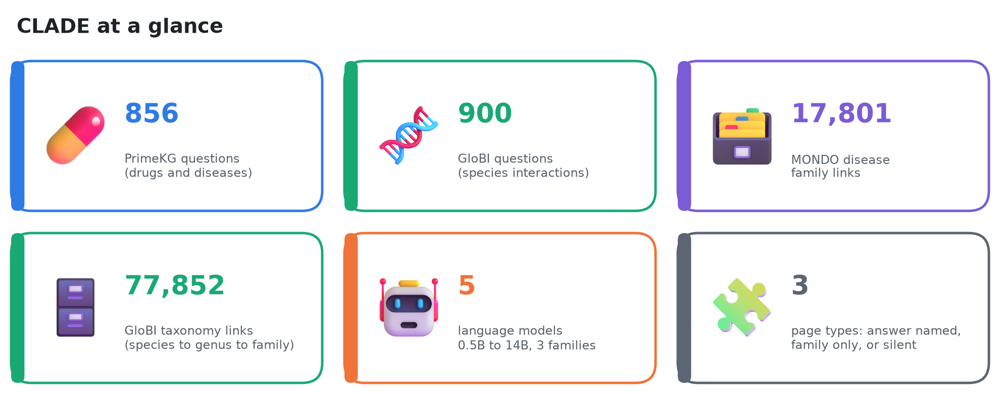
</div>

We use two domains. Each has a graph of facts and a tree of families.

| | 🩺 Domain 1: PrimeKG | 🦋 Domain 2: GloBI |
|---|---|---|
| Facts | drug → disease | species → species |
| Relations | treats · must not take | eats · preys on · parasite of · pollinates |
| Family tree | MONDO disease ontology | taxonomy: species → genus → family |
| Pages | Wikipedia + PubMed | Wikipedia |
| Questions | 856 | 900 |
| Models | 5 | 3 |

### 🩺 Domain 1: PrimeKG + MONDO

PrimeKG is a big biomedical **knowledge graph**. MONDO places each disease inside a family.
Here is one real question from our set:

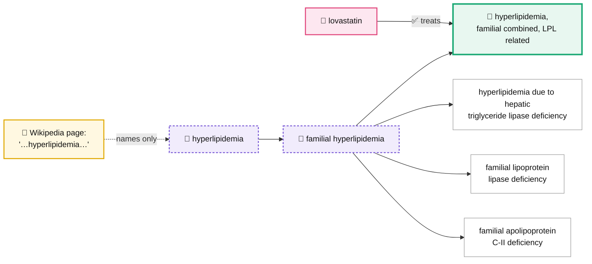

| PrimeKG item | Count |
|---|---:|
| 🗄️ PrimeKG rows | 8,100,498 |
| ✅ Indication / ⛔ contraindication edges | 9,388 / 30,675 |
| 📁 MONDO child → parent rows | 17,801 |
| 💊 Drugs in the question pool | 574 |
| ❓ Questions (150 per page type per relation) | 856 |

**Why the problem lives here:** we check which edges reach the model through text. For Qwen2.5 0.5B, over 1,800 edges:

| | 🧠 Model knows it | 🤷 Model does not |
|---|---:|---:|
| 📖 Text names it | 5.2% | 6.2% |
| 🚫 Text does not name it | 22.2% | **66.4%** |

Two in three facts reach the model neither through text nor through memory.
And a page with just the family name gives *no* gain over a silent page (Qwen2.5 7B, closed book):

| Relation | 🟢 Named | 🟡 Family only | ⚪ Silent |
|---|---:|---:|---:|
| ✅ Indication | 84.2 | 44.7 | 44.0 |
| ⛔ Contraindication | 32.5 | 18.8 | 23.4 |

### 🦋 Domain 2: GloBI + taxonomy

GloBI (Global Biotic Interactions) records who eats, hunts, parasitizes or pollinates whom.
The taxonomy plays the role that MONDO plays for diseases.

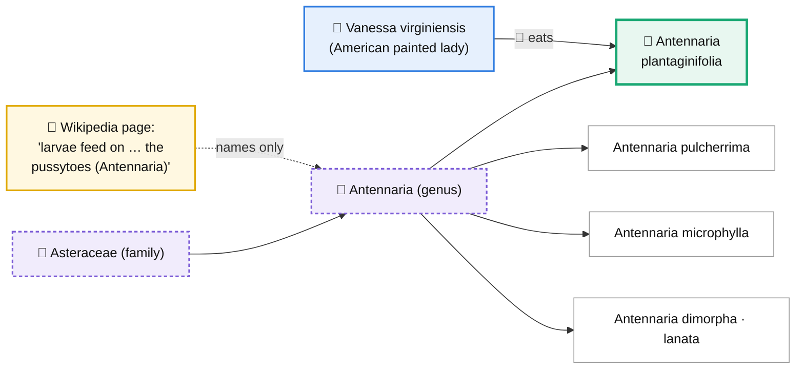

| GloBI item | Count |
|---|---:|
| 🗄️ Interaction records in the dump | 7,822,670 |
| 🔗 Species-to-species edges | 457,386 |
| 🍃 eats · 🦈 preys on · 🪱 parasite of · 🐝 pollinates | 235,960 · 87,678 · 117,894 · 15,854 |
| 🌳 Taxonomy child → parent rows | 77,852 |
| 📁 Genera with two or more species | 8,370 |
| 📖 Edges we measured (5,425 articles) | 23,694 |
| ❓ Questions (75 per page type per relation) | 900 |

**Why the problem lives here:** in GloBI, a page names the partner species only **3.9%** of the time.
It names only the genus or family **7.1%** of the time. It says nothing **89.1%** of the time.
So a family-only page is twice as common as a named one.

Full sources, versions and licenses: [`DATA.md`](DATA.md).

---

## ⚙️ The method

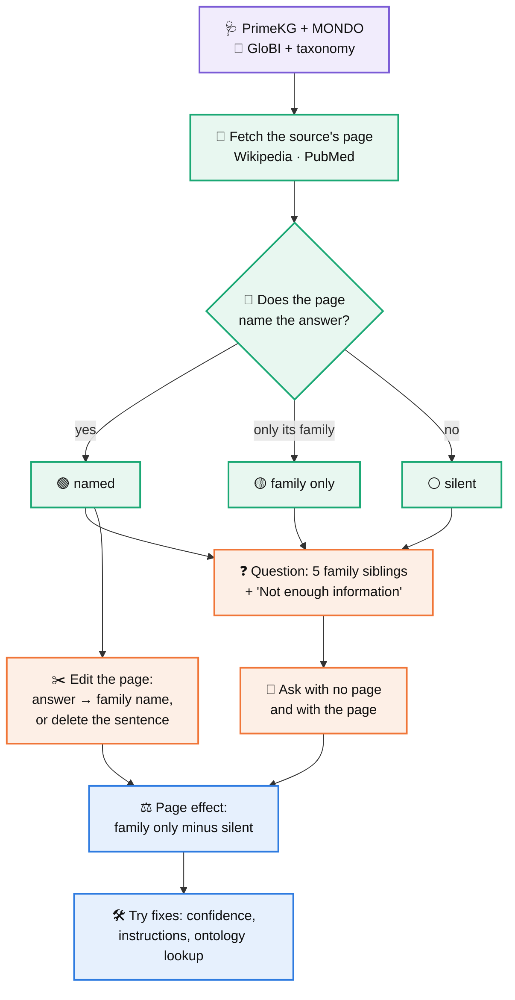

**In plain steps:**

1. 📖 We fetch the page for the question's source (a drug or a species).
2. 🔎 We sort the page: it names the answer, names only its family, or says nothing.
3. ❓ We build a question. The wrong options are the answer's siblings. We add "Not enough information to tell".
4. 🤖 We ask each model twice: with no page, then with the page.
5. ⚖️ We measure the page effect. We subtract the silent-page effect from the family-only effect. Both pages lack the answer, so any difference comes from the family name.
6. ✂️ We take named pages and rewrite them: we swap the answer for its family name, or we delete the sentence. Same question, same page, one change.
7. 🛠️ We test three easy fixes and an ontology lookup.

### 🤖 The models

| Model | Size | PrimeKG | GloBI |
|---|---|:---:|:---:|
| Qwen2.5 Instruct | 0.5B · 7B · 14B | ✅ | 7B ✅ |
| OLMo 2 Instruct | 7B | ✅ | ✅ |
| Granite 3.1 Instruct | 8B | ✅ | ✅ |

We pool the three 7–8B models for the main tests. All models run on CPU in fp32.

---

## 📊 Results

### 1️⃣ A family-only page makes models guess more and decline less

<div align="center">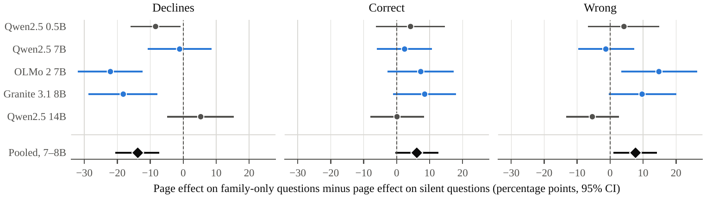</div>

Outcomes with the page, PrimeKG (%):

| Model | Page | ✅ Correct | ❌ Wrong | 🙅 Declined | 🎯 Precision |
|---|---|---:|---:|---:|---:|
| Qwen2.5 7B | 🟢 named | 71.7 | 3.8 | 24.5 | 95.0 |
| | 🟡 family | 26.5 | 18.1 | 55.3 | 59.4 |
| | ⚪ silent | 13.8 | 2.5 | 83.8 | 84.6 |
| OLMo 2 7B | 🟢 named | 77.4 | 15.1 | 7.5 | 83.7 |
| | 🟡 family | 37.2 | **44.7** | 18.1 | 45.5 |
| | ⚪ silent | 30.6 | 24.4 | 45.0 | 55.7 |
| Granite 3.1 8B | 🟢 named | 72.6 | 7.5 | 19.8 | 90.6 |
| | 🟡 family | 30.2 | 26.5 | 43.3 | 53.3 |
| | ⚪ silent | 15.0 | 10.0 | 75.0 | 60.0 |
| Qwen2.5 0.5B | 🟢 named | 77.4 | 14.2 | 8.5 | 84.5 |
| | 🟡 family | 34.4 | **55.8** | 9.8 | 38.1 |
| | ⚪ silent | 28.7 | 50.6 | 20.6 | 36.2 |
| Qwen2.5 14B | 🟢 named | 67.9 | 2.8 | 29.2 | 96.0 |
| | 🟡 family | 24.2 | 17.2 | 58.6 | 58.4 |
| | ⚪ silent | 11.9 | 2.5 | 85.6 | 82.6 |

*Precision = correct ÷ (correct + wrong): how often an answer is right when the model does answer.*

Pooled over the 7–8B models, family-only vs. silent:

| | 🩺 PrimeKG | 🦋 GloBI |
|---|---|---|
| 🙅 Declines | **−13.8** [−20.3, −7.5], p = 3.6e-5 | **−14.3** [−18.7, −9.6], p = 1.4e-9 |
| ❌ Wrong answers | **+7.7** [+1.2, +14.0] | **+11.6** [+7.5, +15.4] |

**What it means:** the family name does not help the model find the answer. It only makes the model feel allowed to answer.

### 2️⃣ The page edit proves the family name causes it

<div align="center">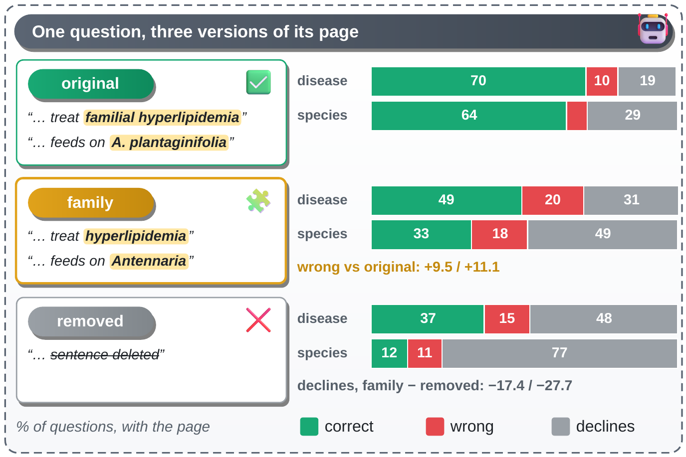</div>

We take one named page and make two copies. In one, the answer becomes its family name. In the other, we delete the sentence.

| Edit: family name vs. sentence removed | 🩺 PrimeKG (130 q) | 🦋 GloBI (255 q) |
|---|---|---|
| 🙅 Declines | **−17.4** [−23.6, −11.5] | **−27.7** [−32.2, −23.5] |
| ❌ Wrong answers | +5.1 | +6.7 |

| Model (PrimeKG) | 🙅 Declines, sentence removed | 🙅 Declines, family name |
|---|---:|---:|
| Qwen2.5 7B | 70.0 | 43.8 |
| Granite 3.1 8B | 56.2 | 40.8 |
| OLMo 2 7B | 18.5 | 7.7 |

**What it means:** same page, same question, one swap. The family name alone cuts declines by 17 points on PrimeKG and 28 points on GloBI.

### 3️⃣ Same story in both domains

<div align="center">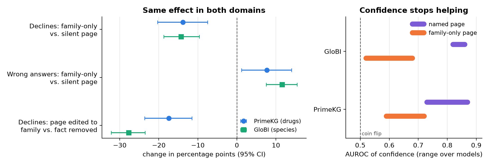</div>

| GloBI model | 🎯 Precision: 🟢 named | 🟡 family | ⚪ silent |
|---|---:|---:|---:|
| Qwen2.5 7B | 94.6 | 27.8 | 25.0 |
| OLMo 2 7B | 84.4 | 26.8 | 28.1 |
| Granite 3.1 8B | 89.4 | 21.7 | 44.4 |

On GloBI, precision on family-only pages is 22–28%. Chance is 20%. So these answers are close to random picks inside the genus.

### 4️⃣ Easy fixes do not solve it

<div align="center">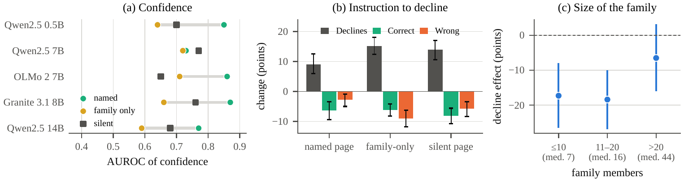</div>

| Fix | What we find |
|---|---|
| 📉 **Use confidence to filter** | AUROC drops from 0.73–0.87 (named) to 0.59–0.72 (family only). GloBI: 0.82–0.86 → 0.52–0.68. Confidence cannot spot these guesses. |
| 🗣️ **Tell the model to decline on a broad category** | Declines rise everywhere: +9.1 on named pages, +15.2 on family-only, +14.0 on silent. The model also throws away good answers. |
| 📏 **Hope big families scare the model** | The effect stays large for families up to 20 members (−17.3, −18.4). It shrinks only past 20 (−6.5). |

### 5️⃣ The ontology can close the gap, if the agent finds the family

<div align="center">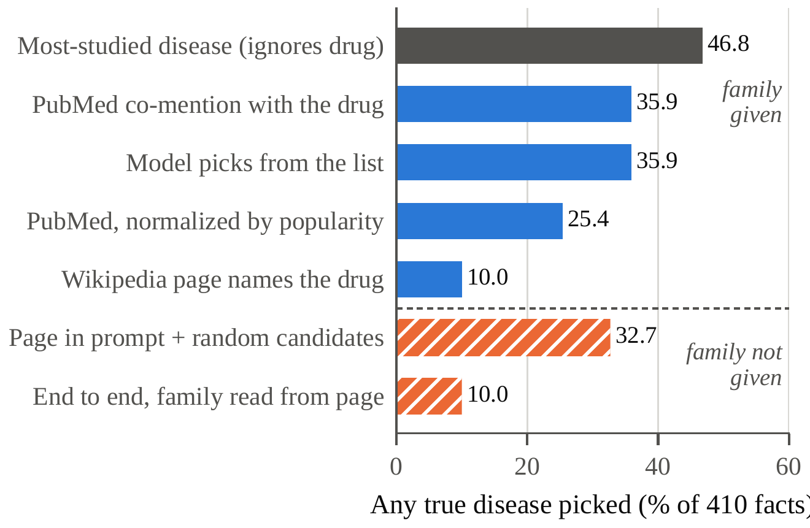</div>

| Step | Result |
|---|---|
| 📁 Given the family, the list holds the answer | **98.5%** (median 14 candidates) |
| 🔎 The agent finds the right family from the page alone | only **19.8%** |
| 🏆 Best way to choose inside the family | popularity 46.8% · evidence then model 41.7% · model alone 35.9% · PubMed 35.9% · page in prompt 32.7% |
| 🔁 End to end recovery | 10.0% (Wikipedia) · 1.5% (Wikipedia + PubMed) |

**What it means:** the list is almost always right. The hard parts are finding the family and choosing within it.
Some misses are not really misses. For carboplatin, the pick is ovarian carcinoma, a better-studied family member than the graph's germ cell tumor. Moxifloxacin for Legionnaires' disease is true, but the graph does not list it.

### 6️⃣ A first fix: let the model choose the family

We show Qwen2.5-7B the page and the families it names (up to ten), and ask which one holds the answer. We expand only that family.

| How we pick the family | List holds the answer | Any true answer |
|---|---:|---:|
| 🧱 All families on the page (string match) | 19.8% | 24.6% |
| 🤖 **The model picks one** | **30.0%** | **44.9%** |
| 1️⃣ The first family the page mentions | 25.1% | 37.3% |
| 🎲 A random family | 13.9% | 22.0% |
| 🔝 Ceiling: any family shown | 50.0% | 64.6% |

End to end, with no oracle at any step, recovery rises from **10.0%** to **26.8%** (popularity prior) or **19.3%** (evidence).
For half of the facts, the right family is not among the families on the page at all, so the ceiling is 50%.

### 7️⃣ Free text tells the same story

We ask 120 questions (40 per page type) with no options, and score the written answer by name matching.

| Model | 🎯 Exact answer from a family-only page | 📁 Answers with the family name itself | 🙅 Abstention, family-only minus silent |
|---|---:|---:|---:|
| Qwen2.5 7B | 0% | 17.5% | −5.0 |
| OLMo 2 7B | 0% | 20.0% | −17.5 |
| Granite 3.1 8B | 0% | 45.0% | −10.0 |

**What it means:** without options, models do not guess a sibling. They give the coarse family ("acute myeloid leukemia") as if it were the answer. The abstention drop points the same way in all three models, but 40 questions per group is too few for any single model to be significant.

---

## 🔬 Case studies

Real questions, real pages, real answers from our three 7–8B models.

<table>
<tr>
<th width="25%">🟢 Named<br/><sub>GloBI · eats</sub></th>
<th width="25%">🟡 Family only<br/><sub>GloBI · eats</sub></th>
<th width="25%">⚪ Silent<br/><sub>GloBI · eats</sub></th>
<th width="25%">🟡 Family only<br/><sub>PrimeKG · treats</sub></th>
</tr>
<tr valign="top">
<td>

🐛 ***Orgyia vetusta***<br/>(western tussock moth)

📄 The page names **"toyon"**, the common name of the answer.

🎯 *Photinia arbutifolia*

🤖 Qwen 🙅 · OLMo 🙅 · Granite 🙅

💬 All three decline. They do not link the common name to the Latin name.

</td>
<td>

🦋 ***Vanessa virginiensis***<br/>(American painted lady)

📄 "The larvae feed on … the pussytoes (*Antennaria*)"

🎯 *Antennaria plantaginifolia*

🤖 Qwen 🙅 · OLMo ❌ *A. microphylla* · Granite ❌ *A. pulcherrima*

💬 Two models pick a wrong sibling. This is CLADE.

</td>
<td>

🐟 ***Cottunculus microps***<br/>(polar sculpin)

📄 The page covers its range and body. It says nothing about food.

🎯 *Lumpenus lampretaeformis*

🤖 Qwen 🙅 · OLMo 🙅 · Granite 🙅

💬 All three decline. This is the right call.

</td>
<td>

💊 **lovastatin**

📄 The page says **"hyperlipidemia"**.

🎯 hyperlipidemia, familial combined, LPL related

🤖 Qwen ✅ · Granite ✅ · OLMo ❌ *hyperlipidemia due to hepatic triglyceride lipase deficiency*

💬 Qwen 0.5B and 14B make the same wrong pick as OLMo.

</td>
</tr>
</table>

🙅 declined · ✅ correct · ❌ wrong

---

## 💡 What it means

A family-only page is not a dead end. It is a **handover point**.

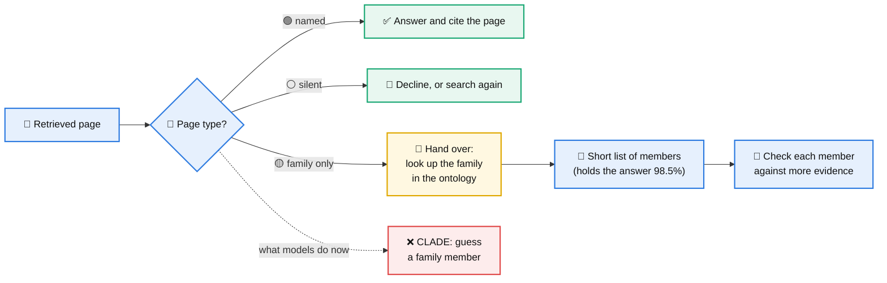

- 🏷️ **Label the page type first.** A cheap name check tells an agent if a page names the answer or only its family.
- 🧭 **Route family-only pages to the ontology.** Do not let the reader answer from them.
- 📏 **Report results by page type.** One overall accuracy hides this failure.

---

## ⚠️ Limitations

- 🔤 Our page check works on names. It misses an answer that the page describes in other words.
- 🗄️ The graphs are our ground truth. They miss some true facts, so we undercount correct answers.
- ❓ Our main test uses multiple-choice questions. Our free-text check is small (40 questions per group).
- 🤖 We test open models up to 14B. We do not test large closed models.
- 🦋 GloBI's taxonomy comes from its own records. A few species may sit under the wrong genus.

## 🔭 Future work

- 🤖 Build the full handover agent and test it end to end.
- 🔎 Improve the family finder. A prompted model reaches 30.0%; the ceiling on Wikipedia is 50.0%.
- 🌍 Add more domains: chemistry, genes, law.
- 💬 Run the free-text check at full scale.
- 📈 Test larger and closed models.

---

## ▶️ Run it

```bash
# 1. Check every shipped number (5 minutes, no GPU, no network)
bash tools/check_results.sh          # expect: identical: 22

# 2. Test both pipelines on tiny fake data (minutes)
bash run_all.sh --smoke              # PrimeKG
bash globi.sh --smoke all            # GloBI

# 3. Run everything from scratch (SLURM cluster)
export CONTACT="you@example.org"     # for the Wikipedia User-Agent
bash run_all.sh                      # PrimeKG
bash globi.sh download && bash globi.sh prepare
GLOBI_N=8000 bash globi.sh text && bash globi.sh models

# 4. Two follow-up tests on the finished PrimeKG run
bash extras.sh submit      # step-2 family chooser + free-text check (SLURM)
bash extras.sh score       # login node: PubMed counts, end-to-end tables
bash extras.sh report
```

All settings live in [`config.sh`](config.sh) and [`config_globi.sh`](config_globi.sh). Each step resumes if it stops.

## 🗂️ What is where

| Path | What it holds |
|---|---|
| 📜 `run_all.sh`, `pipeline.sh` | Run the PrimeKG study, step by step |
| 🦋 `globi.sh` | Run the GloBI study, step by step |
| ➕ `extras.sh` | The family chooser and the free-text check |
| ⚙️ `config*.sh` | All settings: account, models, data links |
| 🐍 `scripts/` | Analysis and model scripts |
| 🗄️ `derived_data/` | PrimeKG and GloBI files the analysis reads |
| 📊 `results/`, `results/globi/` | Every number, log and per-question answer |
| 🧪 `tests/`, `tools/` | Fake-data tests and the result checker |
| 📄 `paper/` | The paper and supplement: LaTeX sources and PDFs |
| 🖼️ `docs/figures/` | Figures for this page |

---
